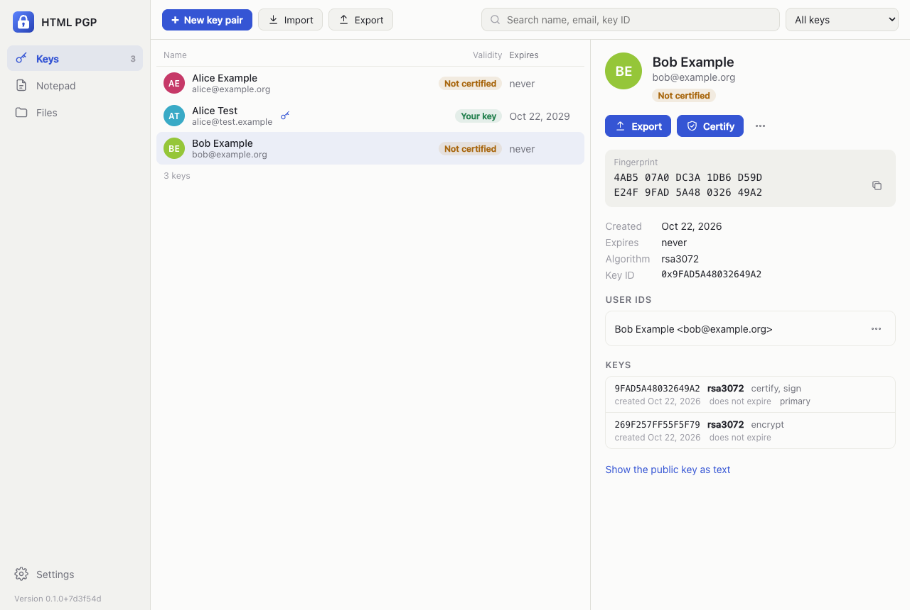

# html-pgp

<!-- languages -->
<h3 align="center">
<a href="../../README.md">🇬🇧 English</a> ·
<a href="README.zh.md">🇨🇳 中文</a> ·
<b>🇮🇳 हिन्दी</b> ·
<a href="README.es.md">🇪🇸 Español</a> ·
<a href="README.fr.md">🇫🇷 Français</a> ·
<a href="README.ar.md">🇸🇦 العربية</a> ·
<a href="README.bn.md">🇧🇩 বাংলা</a> ·
<a href="README.pt.md">🇧🇷 Português</a> ·
<a href="README.ru.md">🇷🇺 Русский</a> ·
<a href="README.ur.md">🇵🇰 اردو</a> ·
<a href="README.id.md">🇮🇩 Bahasa Indonesia</a> ·
<a href="README.de.md">🇩🇪 Deutsch</a> ·
<a href="README.ja.md">🇯🇵 日本語</a> ·
<a href="README.mr.md">🇮🇳 मराठी</a> ·
<a href="README.te.md">🇮🇳 తెలుగు</a> ·
<a href="README.tr.md">🇹🇷 Türkçe</a> ·
<a href="README.uk.md">🇺🇦 Українська</a>
</h3>
<!-- /languages -->

**HTML PGP** एक OpenPGP कुंजी प्रबंधक और एन्क्रिप्शन टूल है, जो
[Kleopatra](https://apps.kde.org/kleopatra/) की तर्ज़ पर बना है — Kleopatra वह प्रमाणपत्र प्रबंधक है जो GnuPG के साथ आता है — और यह एक अकेली, स्वतंत्र HTML फ़ाइल में है। यह आपकी अपनी कुंजी जोड़ियों और दूसरों की सार्वजनिक कुंजियों की कीरिंग रखता है, नई कुंजियाँ बनाता है (RSA, Curve25519, NIST और Brainpool कर्व, OpenPGP v6 Ed25519 और Ed448), कुंजियों को प्रमाणित करता है, और टेक्स्ट व फ़ाइलों को एन्क्रिप्ट, हस्ताक्षर, डिक्रिप्ट और सत्यापित करता है।

यह वही OpenPGP बोलता है जो GnuPG और Kleopatra बोलते हैं: कुंजियाँ, संदेश और हस्ताक्षर दोनों दिशाओं में चलते हैं, और परीक्षण इसे स्वयं GnuPG के विरुद्ध जाँचते हैं।

सब कुछ ऑफ़लाइन चलता है: न खाता, न सर्वर, न नेटवर्क अनुरोध — पेज के पास नेटवर्क की कोई पहुँच ही नहीं है। कुंजियाँ ब्राउज़र में रखी जाती हैं; गुप्त कुंजियाँ अपने पासफ़्रेज़ से एन्क्रिप्टेड रहती हैं, और पासफ़्रेज़ कभी सहेजे नहीं जाते। यही पेज एक [PWA](#github-pages) भी है जो ऐप की तरह इंस्टॉल होता है, और एक [Chrome एक्सटेंशन](#chrome-एक्सटेंशन) भी, जो आपके टैब के बगल में खुलता है।



## उपयोग कैसे करें

`build/html-pgp.html` बनाएँ (देखें "[बिल्ड](#बिल्ड)") और उसे ब्राउज़र में खोलें — सीधे डिस्क से खोलना ठीक है। या GitHub Pages से PWA, या एक्सटेंशन इस्तेमाल करें।

ऐप में तीन व्यू हैं, जैसे Kleopatra में: **कुंजियाँ**, **नोटपैड** और **फ़ाइलें**, तथा **सेटिंग**।

### कुंजियाँ

- **नई कुंजी जोड़ी** — आपका नाम और ईमेल पता, और एक पासफ़्रेज़ जो गुप्त कुंजी की रक्षा करता है। "एल्गोरिदम और वैधता" के अंतर्गत: एल्गोरिदम (देखें "[एल्गोरिदम](#एल्गोरिदम)") और कुंजी कितने समय तक वैध रहे — डिफ़ॉल्ट रूप से तीन वर्ष, जैसा GnuPG और Kleopatra बनाते हैं। कुंजी बनने के बाद ऐप तुरंत उसका बैकअप लेने का सुझाव देता है: कीरिंग केवल इसी ब्राउज़र में रहती है।
- **इम्पोर्ट** — किसी फ़ाइल से (`.asc`, `.gpg`, `.key`…, हर एक में एक या कई कुंजियाँ, आर्मर्ड या बाइनरी), क्लिपबोर्ड से, या टेक्स्ट के रूप में पेस्ट करके। कुंजी व्यू पर छोड़ी गई फ़ाइलें भी इम्पोर्ट होती हैं। जो कुंजी कीरिंग में पहले से है, उसे मिला दिया जाता है: नई उपयोगकर्ता ID, उपकुंजियाँ और हस्ताक्षर उसमें जुड़ जाते हैं, और गुप्त कुंजी अपनी सार्वजनिक कुंजी से जुड़ जाती है। GnuPG का निरस्तीकरण प्रमाणपत्र (`.rev`) आपकी पुष्टि के बाद ही इम्पोर्ट होता है: वह कुंजी को सदा के लिए निरस्त कर देता है।
- **एक्सपोर्ट** — चुनी हुई सार्वजनिक कुंजियाँ, टेक्स्ट (`.asc`) या बाइनरी (`.gpg`) रूप में, फ़ाइल या क्लिपबोर्ड में। ⌘/Ctrl और Shift से कई कुंजियाँ चुनी जा सकती हैं।
- सूची में हर कुंजी का नाम, पता, वैधता, समाप्ति तिथि और कुंजी ID दिखता है; खोज नाम, पते, कुंजी ID या फ़िंगरप्रिंट से कुंजियाँ ढूँढती है, और फ़िल्टर आपकी कुंजी जोड़ियाँ, प्रमाणित कुंजियाँ, जिन्हें किसी ने प्रमाणित नहीं किया वे कुंजियाँ, या समाप्त और निरस्त कुंजियाँ दिखाता है।

किसी कुंजी के विवरण में उसका फ़िंगरप्रिंट चार-चार के समूहों में दिखता है, जैसा GnuPG छापता है, साथ में उसकी उपयोगकर्ता ID और उन्हें किसने प्रमाणित किया, प्राथमिक कुंजी और उपकुंजियाँ उनके एल्गोरिदम, उपयोग और तिथियों सहित, और सार्वजनिक कुंजी टेक्स्ट के रूप में। आपकी अपनी कुंजियों के लिए ⋯ मेनू में ये भी हैं:

- **समाप्ति तिथि बदलें** — कुंजी और उसकी उपकुंजियों के लिए नई तिथि, या कोई नहीं। इसके बाद सार्वजनिक कुंजी फिर से साझा करें, ताकि दूसरे उसे देख सकें।
- **उपयोगकर्ता ID जोड़ें** — उसी कुंजी के लिए एक और नाम या पता। प्राथमिक ID प्राथमिक ही रहती है।
- **पासफ़्रेज़ बदलें** — पहले मौजूदा पासफ़्रेज़ पूछा जाता है, भले ही वह याद रखा गया हो। खाली पासफ़्रेज़ चेतावनी के बाद कुंजी को असुरक्षित छोड़ देता है।
- **गुप्त कुंजी का बैकअप** — गुप्त कुंजी, अब भी अपने पासफ़्रेज़ के अधीन, `Name_0xKEYID_SECRET.asc` के रूप में। पासफ़्रेज़ पहले पूछा जाता है, ताकि पता रहे कि बैकअप खुलेगा।
- **निरस्तीकरण प्रमाणपत्र** — वह जो कुंजी के साथ बना था, जिसे कुंजी से अलग रखना चाहिए: यदि कुंजी खो जाए या चोरी हो जाए, तो प्रमाणपत्र इम्पोर्ट करें और निरस्त कुंजी साझा करें।
- **कुंजी निरस्त करें**, और कई उपयोगकर्ता ID में से किसी एक को **निरस्त करें**।

### प्रमाणित करना

किसी कुंजी को प्रमाणित करने का अर्थ है "मैंने जाँच लिया है कि यह कुंजी इसी व्यक्ति की है"। पहले फ़िंगरप्रिंट उसके स्वामी के साथ जाँचें — आमने-सामने, या ऐसी कॉल पर जहाँ आप उनकी आवाज़ पहचानते हों — फिर कुंजी के विवरण में **प्रमाणित करें** दबाएँ और उपयोगकर्ता ID चुनें। प्रमाणन आपकी कुंजी की प्राथमिक कुंजी से बनता है, जैसा GnuPG बनाता है, और GnuPG उसे स्वीकार करता है।

वैधता वेब ऑफ़ ट्रस्ट की Kleopatra वाली सबसे सरल व्याख्या का अनुसरण करती है: आपकी अपनी कुंजियों पर पूर्ण भरोसा है; जिस कुंजी को आपने प्रमाणित किया वह **प्रमाणित** है; कोई भी अन्य कुंजी काम करती है, पर जहाँ भी उपयोग हो वहाँ **प्रमाणित नहीं** चिह्नित रहती है — सूची में, प्राप्तकर्ताओं के बीच, और उसके बनाए हस्ताक्षर पर।

### नोटपैड

संदेश लिखें, **प्राप्तकर्ता** चुनें — टाइप करते समय नाम, पते या कुंजी ID से मिल जाते हैं — और **एन्क्रिप्ट करें** दबाएँ, या जब "इस रूप में हस्ताक्षर करें" के अंतर्गत कोई कुंजी चुनी हो तब **हस्ताक्षर करें और एन्क्रिप्ट करें**। "मेरे लिए भी एन्क्रिप्ट करें" आपकी अपनी कुंजी जोड़ देता है, ताकि आप भेजा हुआ संदेश पढ़ सकें। "पासवर्ड से एन्क्रिप्ट करें" एक पासवर्ड जोड़ता है जिससे कोई भी डिक्रिप्ट कर सके, प्राप्तकर्ताओं के साथ या उनके बदले। **केवल हस्ताक्षर करें** क्लियर-साइन्ड टेक्स्ट बनाता है: फिर भी पढ़ने योग्य, हस्ताक्षर उसके नीचे।

एन्क्रिप्टेड या हस्ताक्षरित संदेश पेस्ट करें और **डिक्रिप्ट / सत्यापित करें** दबाएँ: टेक्स्ट वहीं डिक्रिप्ट हो जाता है — ज़रूरत पड़ने पर आपकी कुंजी का पासफ़्रेज़ पूछा जाता है — और उस पर मौजूद हर हस्ताक्षर जाँचा जाता है: सही, गलत (टेक्स्ट बदला गया), या ऐसी कुंजी से बना जो आपकी कीरिंग में नहीं है। "मूल टेक्स्ट दिखाएँ" वापस ले जाता है। ⌘/Ctrl+Enter संदेश को डिक्रिप्ट करता है, या सादे टेक्स्ट को एन्क्रिप्ट करता है। पेस्ट की गई कुंजी को इम्पोर्ट करने का सुझाव दिया जाता है।

### फ़ाइलें

बटन से फ़ाइलें जोड़ें या उन्हें विंडो पर छोड़ दें। हर फ़ाइल को देखकर पहचाना जाता है कि वह क्या है: सादी फ़ाइल, एन्क्रिप्टेड, हस्ताक्षरित, अलग हस्ताक्षर (detached), कुंजियाँ या निरस्तीकरण प्रमाणपत्र।

- **हस्ताक्षर / एन्क्रिप्ट करें** — सादी फ़ाइलों के लिए: अपनी किसी कुंजी से हस्ताक्षर करें, अपने लिए, दूसरों के लिए, पासवर्ड से एन्क्रिप्ट करें, या इनमें से कई एक साथ। एन्क्रिप्टेड फ़ाइलों को `.gpg` मिलता है (या टेक्स्ट के रूप में `.asc`); केवल हस्ताक्षर करने पर हर फ़ाइल के बगल में अलग हस्ताक्षर बनता है, `.sig` (या `.asc`)।
- **डिक्रिप्ट / सत्यापित करें** — बाकी के लिए। अलग हस्ताक्षर अपने नाम से उस फ़ाइल को ढूँढ लेता है जिस पर उसने हस्ताक्षर किया है (`report.pdf.sig` का जोड़ `report.pdf` से है), या उसे पूछता है। डिक्रिप्ट की गई फ़ाइलों के नाम एन्क्रिप्टेड फ़ाइलों के नाम से `.gpg` हटाकर बनते हैं।
- **कुंजियाँ इम्पोर्ट करें** — यहाँ छोड़ी गई कुंजी फ़ाइलों के लिए।

हर परिणाम अपने बटन से सहेजा जाता है, या सब एक साथ।

### पासफ़्रेज़

एक बार अनलॉक की गई गुप्त कुंजी कुछ समय तक अनलॉक रहती है, जैसे gpg-agent उसे रखता है: डिफ़ॉल्ट रूप से 10 मिनट, सेटिंग में "हर बार पूछें" से लेकर चार घंटे तक। केवल डिक्रिप्ट की गई कुंजी रखी जाती है, पेज की मेमोरी में — पासफ़्रेज़ कभी नहीं, डिस्क पर कभी नहीं। मेनू में **पासफ़्रेज़ भुलाएँ** सबको एक साथ लॉक कर देता है; पेज रीलोड करने से भी यही होता है।

### फ़ोन पर

पेज फ़ोन पर चलता है: एक समय में एक स्क्रीन, व्यू नीचे टैब बार में, किसी कुंजी का विवरण अपनी अलग स्क्रीन पर वापस बटन के साथ — सिस्टम का बैक जेस्चर भी काम करता है — और मेनू नीचे से ऊपर उठते हुए। iOS पर सहेजी गई फ़ाइल शेयर शीट में जाती है, जहाँ "Save to Files" होता है।

## एल्गोरिदम

| विकल्प | GnuPG नाम | टिप्पणियाँ |
| --- | --- | --- |
| ECC Curve25519 | ed25519 + cv25519 | डिफ़ॉल्ट, जैसा GnuPG और Kleopatra में: छोटी, तेज़, हर जगह पढ़ी जाने वाली। |
| ECC NIST P-256, P-384, P-521 | nistp256, nistp384, nistp521 | ECDSA और ECDH। |
| ECC Brainpool P-256, P-384, P-512 | brainpoolP256r1… | ECDSA और ECDH; जर्मन और यूरोपीय उपयोग में आम। |
| RSA 2048, 3072, 4096 | rsa2048… | सबसे पुराना और सबसे व्यापक रूप से पढ़ा जाने वाला; बनने में कुछ सेकंड लगते हैं। |
| Ed25519 + X25519 (OpenPGP v6) | ed25519 + x25519 | RFC 9580 कुंजियाँ। **GnuPG और Kleopatra इन्हें अभी नहीं पढ़ सकते।** |
| Ed448 + X448 (OpenPGP v6) | ed448 + x448 | RFC 9580 कुंजियाँ, ऊपर की तरह। |

हर कुंजी एक प्राथमिक कुंजी होती है जो प्रमाणित और हस्ताक्षर करती है, और एक उपकुंजी जो एन्क्रिप्ट करती है, जैसा GnuPG उन्हें बनाता है। अन्य एल्गोरिदम की कुंजियाँ — उदाहरण के लिए पुरानी GnuPG कीरिंग की DSA और ElGamal — पढ़ी और इस्तेमाल की जाती हैं; बस उनकी नई कुंजियाँ नहीं बनाई जातीं। secp256k1 छोड़ा गया है: openpgp.js उसे तब तक अस्वीकार करता है जब तक अन्यथा न कहा जाए।

## GnuPG और Kleopatra के साथ संगतता

`tests/gnupg.mjs` स्वयं GnuPG को एक अस्थायी होम डायरेक्टरी में चलाता है, उस पर जो ऐप लिखता है, और `tests/pgp.mjs` वह पढ़ता है जो GnuPG ने लिखा (`tests/fixtures/gnupg/`, जो `tools/gnupg-fixtures.sh` से एक बार बनाया गया)। दोनों दिशाओं में जाँचा गया:

- यहाँ बनी हर v4 एल्गोरिदम की कुंजियाँ GnuPG उनके उपयोग सहित इम्पोर्ट करता है, और इस्तेमाल करता है: GnuPG हमारे संदेश डिक्रिप्ट करता है और हमारे हस्ताक्षर जाँचता है, और GnuPG जो उनके लिए एन्क्रिप्ट करता है उसे हम डिक्रिप्ट करते हैं;
- GnuPG हमारी नई समाप्ति तिथियाँ, जोड़ी और निरस्त की गई उपयोगकर्ता ID, दूसरी कुंजियों के प्रमाणन और निरस्तीकरण प्रमाणपत्र देखता है;
- GnuPG की कुंजियाँ, संदेश (उसके OCB-एन्क्रिप्टेड संदेशों सहित), क्लियर-साइन्ड टेक्स्ट, अलग हस्ताक्षर, पासवर्ड-एन्क्रिप्टेड संदेश और निरस्तीकरण प्रमाणपत्र यहाँ पढ़े जाते हैं।

अपनी कुंजियाँ Kleopatra से लाने के लिए: अपनी कुंजी जोड़ी चुनें → गुप्त कुंजियाँ एक्सपोर्ट करें (या "गुप्त कुंजियों का बैकअप"), और फ़ाइल यहाँ इम्पोर्ट करें; दूसरों की सार्वजनिक कुंजियाँ भी एक्सपोर्ट से इसी तरह। यहाँ से वापस ले जाने के लिए: सार्वजनिक कुंजी एक्सपोर्ट करें, या गुप्त कुंजी का बैकअप लें, और फ़ाइल Kleopatra में इम्पोर्ट करें।

## Chrome एक्सटेंशन

वही ऐप Chrome के साइड पैनल में, उस पेज के बगल में जिसे आप पढ़ रहे हैं। टूलबार का बटन उसे खोलता है। किसी भी पेज पर — वेबमेल, फ़ोरम, टेक्स्ट फ़ील्ड में — एन्क्रिप्टेड या हस्ताक्षरित टेक्स्ट चुनें और संदर्भ मेनू में **HTML PGP से डिक्रिप्ट / सत्यापित करें** चुनें: वह पैनल के नोटपैड में खुलता है, डिक्रिप्ट और जाँचा हुआ। **HTML PGP से एन्क्रिप्ट करें** चुना हुआ टेक्स्ट आपको सौंप देता है ताकि आप प्राप्तकर्ता चुनें।

एक्सटेंशन जितना हो सके उतना कम माँगता है: साइड पैनल, संदर्भ मेनू, अपना स्टोरेज, और वह टैब जिसमें आप क्लिक करते हैं (activeTab) — ताकि चयन को उसकी पंक्ति-विरामों सहित पढ़ सके, जो संदर्भ मेनू स्वयं खो देता है। इसके अलावा उसकी किसी वेबसाइट तक कोई पहुँच नहीं है, और उसके पेजों के पास, ऐप की तरह, नेटवर्क की कोई पहुँच नहीं है। जहाँ पेज पढ़ा नहीं जा सकता (Chrome के अपने पेज, Web Store, PDF), वहाँ मेनू की अपनी चयन-प्रति इस्तेमाल होती है और उसका आर्मर उसकी पंक्तियों पर वापस लगाया जाता है।

एक्सटेंशन की अपनी अलग कीरिंग होती है: ब्राउज़र हर origin का डेटा अलग रखते हैं, इसलिए अकेली फ़ाइल, PWA और एक्सटेंशन, हर एक की अपनी है। कुंजियाँ इनके बीच एक्सपोर्ट और इम्पोर्ट से, या बैकअप से ले जाएँ।

इसे `npm run build` से बनाएँ और `build/extension/` को `chrome://extensions` में लोड करें (Developer mode → Load unpacked), या Chrome Web Store के लिए `build/html-pgp-extension-<version>.zip` लें।

## सुरक्षा

- **पेज से कुछ बाहर नहीं जाता।** इसकी Content-Security-Policy में `connect-src 'none'` और `default-src 'none'` है: न fetch, न कहीं और से चित्र या फ़ॉन्ट, न बाहर पोस्ट करने वाले फ़ॉर्म। सब कुछ इनलाइन है — स्टाइल, openpgp.js, आइकन। कोई भी बाहरी `src` या `href` होने पर बिल्ड विफल हो जाता है, और CI बने हुए फ़ाइल को फिर से जाँचता है। PWA की प्रति अपना मैनिफ़ेस्ट, सर्विस वर्कर और आइकन लोड कर सकती है; एक्सटेंशन के पेजों की यही नीति उसके मैनिफ़ेस्ट में है।
- **गुप्त कुंजियाँ एन्क्रिप्टेड रूप में रखी जाती हैं।** कीरिंग ब्राउज़र के IndexedDB में रहती है, हर कुंजी का एक रिकॉर्ड, जैसा openpgp.js उसे आर्मर करता है: गुप्त कुंजी अपने पासफ़्रेज़ से एन्क्रिप्टेड रहती है (AES-256, कुंजी पासफ़्रेज़ से दोहराए गए और सॉल्टेड S2K द्वारा बनाई जाती है, जैसा GnuPG करता है) और केवल ज़रूरत पड़ने पर मेमोरी में डिक्रिप्ट होती है। पासफ़्रेज़ कभी सहेजा नहीं जाता। बिना पासफ़्रेज़ वाली कुंजी को उसके विवरण में वैसा चिह्नित किया जाता है।
- **अनलॉक की गई कुंजियाँ भुला दी जाती हैं** सेटिंग में तय समय के बाद, "पासफ़्रेज़ भुलाएँ" पर, और पेज बंद होने पर।
- **पासफ़्रेज़ फ़ील्ड जान-बूझकर टेक्स्ट इनपुट हैं**, पारदर्शी टेक्स्ट के साथ और उस पर बनाए गए बिंदुओं के साथ। macOS पर पासवर्ड फ़ील्ड Secure Input चालू कर देता है, जो लैटिन कीबोर्ड लेआउट थोपता है: सिरिलिक, यूनानी या अरबी में पासफ़्रेज़ टाइप नहीं हो सकता था। यह फ़ील्ड ब्राउज़र को ऐसा कोई संकेत नहीं देता, फिर भी जो टाइप हुआ उसे छिपाता है, और उसकी कॉपी नहीं होने देता।
- **हस्ताक्षरों का मूल्यांकन उन कुंजियों से होता है जिन पर आप भरोसा करते हैं।** जिस कुंजी को किसी ने प्रमाणित नहीं किया, उसका सही हस्ताक्षर यह बता देता है, और यह भी कि उसका फ़िंगरप्रिंट क्यों जाँचना चाहिए।
- **ब्राउज़र ही भरोसे का आधार है।** जो कुछ भी इस पेज में कोड चला सकता है या ब्राउज़र की प्रोफ़ाइल पढ़ सकता है — सभी साइटों तक पहुँच वाला दुर्भावनापूर्ण एक्सटेंशन, कंप्यूटर पर मैलवेयर — वह पढ़ सकता है जो पेज पढ़ सकता है। अपनी गुप्त कुंजियों के बैकअप कहीं और रखें: ब्राउज़र का डेटा मिटाने से कीरिंग मिट जाती है।

## विशेषताएँ

- IndexedDB में कीरिंग, इस origin पर ऐप की विंडो द्वारा साझा; एक विंडो में बदलाव दूसरों में दिखता है।
- बारह प्रकार की नई कुंजी जोड़ियाँ, समाप्ति तिथि और उनके साथ बने निरस्तीकरण प्रमाणपत्र सहित।
- आर्मर्ड और बाइनरी कुंजियों का इम्पोर्ट, एक साथ कई, जो पहले से है उसमें मिलाकर; GnuPG के निरस्तीकरण प्रमाणपत्र पुष्टि पर।
- सार्वजनिक कुंजियों का एक्सपोर्ट, गुप्त कुंजियों का बैकअप, एक या सभी।
- दूसरों की कुंजियों को प्रमाणित करना; आपके अपने प्रमाणनों से वैधता।
- अपनी कुंजी में बदलाव: समाप्ति तिथि, उपयोगकर्ता ID, पासफ़्रेज़, निरस्तीकरण — हस्ताक्षर जोड़कर, जैसा GnuPG करता है, ताकि कुंजी हर जगह पढ़ी जा सके और दूसरों के प्रमाणन उस पर बने रहें।
- नोटपैड: एन्क्रिप्ट, हस्ताक्षर, हस्ताक्षर और एन्क्रिप्ट, पासवर्ड से एन्क्रिप्ट, डिक्रिप्ट, सत्यापित करें।
- फ़ाइलें: फ़ाइलों के लिए वही, अलग हस्ताक्षर, एक साथ कई फ़ाइलें।
- पासफ़्रेज़ कुछ समय तक याद रखे जाते हैं, केवल मेमोरी में।
- हल्का और गहरा थीम, सिस्टम के अनुसार या चुना हुआ।
- 17 भाषाएँ, अरबी और उर्दू दाएँ से बाएँ।
- फ़ोन के लिए लेआउट; PWA फ़ोन या कंप्यूटर पर इंस्टॉल होता है और ऑफ़लाइन काम करता है।
- Finder या Explorer से इंस्टॉल किए गए PWA के साथ खोली गई फ़ाइलें उसके फ़ाइल व्यू में आती हैं।
- चुने हुए टेक्स्ट के लिए संदर्भ मेनू वाला Chrome एक्सटेंशन।

## कीबोर्ड शॉर्टकट

| कुंजियाँ | |
| --- | --- |
| ⌘/Ctrl+F | कुंजियाँ खोजें |
| ⇧⌘N / Shift+Ctrl+N | नई कुंजी जोड़ी |
| ⇧⌘I / Shift+Ctrl+I | इम्पोर्ट |
| ↑ ↓, Home, End | कुंजी सूची में चलना |
| ⌘/Ctrl+A | सूची की सभी कुंजियाँ चुनना |
| Delete | चुनी हुई कुंजियाँ हटाना |
| ⌘/Ctrl+Enter | नोटपैड में: संदेश डिक्रिप्ट करना, या सादा टेक्स्ट एन्क्रिप्ट करना |
| Esc | डायलॉग या मेनू बंद करना |

## अनुवाद

इंटरफ़ेस अंग्रेज़ी और 16 और भाषाएँ बोलता है: चीनी, हिन्दी, स्पैनिश, फ़्रेंच, अरबी, बांग्ला, पुर्तगाली, रूसी, उर्दू, इंडोनेशियाई, जर्मन, जापानी, मराठी, तेलुगु, तुर्की और यूक्रेनी। यह ब्राउज़र की भाषा का अनुसरण करता है, जब तक सेटिंग में कोई भाषा न चुनी जाए। अरबी और उर्दू दाएँ से बाएँ लिखी जाती हैं।

अंग्रेज़ी पाठ कोड में रहता है: `t('context', 'English text')`, या संख्या वाले टेक्स्ट के लिए `tn('context', '{count} key', '{count} keys', n)`, सादे स्ट्रिंग लिटरल के साथ — `tools/i18n.mjs` उन्हें रेगुलर एक्सप्रेशन से ढूँढता है। टेम्पलेट में `data-i18n` किसी एलिमेंट का टेक्स्ट अनुवादित करता है और `data-i18n-attr` उसका title, placeholder और aria-label। हर भाषा एक शब्दकोश है, `src/locales/<code>.json`: `{ "context": { "English text": "translation" } }`, बहुवचन रूप `Intl.PluralRules` से। जो स्ट्रिंग शब्दकोश में न हो, वह अंग्रेज़ी में दिखती है।

`npm run i18n` हर भाषा के लिए वे स्ट्रिंग छापता है जो शब्दकोश में नहीं हैं और वे जो उसमें हैं पर इंटरफ़ेस अब उपयोग नहीं करता; `npm test` शब्दकोशों की जाँच करता है: कोई पुरानी कुंजी नहीं, वही प्लेसहोल्डर, हर बहुवचन रूप, हर context एक बार। Chrome एक्सटेंशन के बारे में जो दिखाता है — उसका नाम, विवरण और बटन का शीर्षक — वह इन्हीं शब्दकोशों से, context `manifest` से आता है।

## बिल्ड

```sh
npm install
npm run build          # build/html-pgp.html, build/pages/, build/extension/ और उसकी zip
npm run watch          # हर बदलाव पर फिर से बनाता है
./build.sh             # वही, पहली बार चलाने पर निर्भरताएँ इंस्टॉल करता है
```

`build.mjs` esbuild से `src/app/main.ts` को एक स्क्रिप्ट में बंडल करता है और उसे, स्टाइल और आइकन के साथ, `src/app/template.html` में इनलाइन कर देता है। openpgp.js एकमात्र रनटाइम निर्भरता है।

```sh
npm run check          # नीचे का सब कुछ, क्रम से
npm run typecheck      # tsc --noEmit
npm test               # Node में यूनिट टेस्ट; tests/gnupg.mjs को gpg चाहिए, और उसके बिना यह बता देता है
npm run test:browser   # हेडलेस Chrome में पेज, PWA और एक्सटेंशन
npm run shots -- DIR   # हर मुख्य स्क्रीन के स्क्रीनशॉट DIR में
npm run icons          # PNG आइकन, assets/*.svg से बने
```

ब्राउज़र टेस्ट स्थानीय Chrome को DevTools प्रोटोकॉल से चलाते हैं, Node के अलावा किसी निर्भरता के बिना; `CHROME=/path/to/chrome` से कोई एक चुना जाता है।

## संस्करण और रिलीज़

संस्करण केवल `package.json` में रहता है। `v<version>` से टैग किए गए कमिट का बिल्ड उसे जैसा है वैसा दिखाता है; कोई भी अन्य बिल्ड कमिट जोड़ देता है — `0.1.0+1a2b3c4` — ताकि `main` से बना पेज रिलीज़ न समझा जाए। रिलीज़ करने के लिए: `npm version minor && git push --follow-tags`। रिलीज़ वर्कफ़्लो जाँचता है कि टैग `package.json` से मेल खाता है, टेस्ट चलाता है, और `html-pgp-<tag>.html`, `html-pgp-extension-<tag>.zip` और `SHA256SUMS.txt` संलग्न करता है।

## GitHub Pages

`build/pages/` वही पेज है, इंस्टॉल होने वाले PWA के रूप में: एक मैनिफ़ेस्ट, आइकन और एक सर्विस वर्कर जो एक बार खुलने के बाद उसे ऑफ़लाइन चालू रखता है। `.github/workflows/pages.yml` हर `main` पर push के साथ उसे बनाता और टेस्ट करता है और GitHub Pages पर डिप्लॉय करता है (Settings → Pages → Source: GitHub Actions); वह फिर `https://<owner>.github.io/html-pgp/` पर होता है।

पेज अब भी कहीं नहीं पहुँचता: उसकी नीति केवल उसके अपने मैनिफ़ेस्ट, वर्कर और आइकन को आने देती है। नया डिप्लॉय चल रहे संस्करण के बगल में इंस्टॉल होता है और प्रतीक्षा करता है; सेटिंग "संस्करण X तैयार है" दिखाती है, "अपडेट करें" बटन के साथ, और एक बिंदु सेटिंग को चिह्नित करता है। इंस्टॉल किया गया ऐप सिस्टम से `.gpg`, `.pgp`, `.sig` और `.asc` फ़ाइलें भी (Open With से) अपने फ़ाइल व्यू में खोलता है।

## लेआउट

```text
build.mjs                 the build: the single file, the PWA, the extension and its zip
src/core/                 no DOM — runs in Node under the tests
  pgp.ts                  every OpenPGP operation, over openpgp.js
  keys.ts                 what a key is, as the interface shows it
  keyring.ts              the keyring: storage, import and merging, trust
  armor.ts                ASCII armor mended from one line
  i18n.ts                 languages and the lookup of strings
src/app/                  the page
  template.html           the markup, with the CSP
  styles.css              all of the styles
  main.ts                 start-up, views, shortcuts, files dropped, other windows
  keylist.ts              the keys view: list, search, filter, selection
  details.ts              one key in full
  keyactions.ts           the dialogs: new key, import, export, certify, changes, delete
  notepad.ts, files.ts    the notepad and the files view
  recipients.ts           choosing recipients
  outcome.ts              what decrypting and verifying found, in words
  agent.ts                passphrases and unlocked keys
  settings.ts             preferences in localStorage; settingsview.ts the view
  store.ts                IndexedDB, and news of changes from other windows
  save.ts                 files to save, the clipboard
  ui.ts, screens.ts       dialogs, menus, toasts; one screen at a time on a phone
  update.ts, platform.ts  PWA updates; what the extension adds
src/extension/            manifest, background worker, the panel's platform, grab.ts
src/pwa/sw.js             the PWA's service worker
src/locales/              16 dictionaries
tests/                    pgp, keyring, gnupg, i18n in Node; app and extension in Chrome
tests/fixtures/gnupg/     keys, messages and signatures made by GnuPG
tools/                    load.mjs, chrome.mjs, i18n.mjs, shots.mjs, icons.mjs, gnupg-fixtures.sh
```

## सीमाएँ

- कोई की सर्वर या WKD नहीं: पेज के पास डिज़ाइन से ही नेटवर्क की पहुँच नहीं है। कुंजियाँ फ़ाइलों या टेक्स्ट के रूप में आदान-प्रदान करें।
- कोई स्मार्टकार्ड या हार्डवेयर टोकन नहीं। जिन कुंजियों की गुप्त प्राथमिक कुंजी कहीं और रखी है (GnuPG के स्टब) वे पढ़ी जाती हैं, और उनकी उपकुंजियाँ काम करती हैं; ऐसी कुंजी यहाँ बदली नहीं जा सकती।
- कोई S/MIME या X.509 प्रमाणपत्र नहीं — केवल OpenPGP।
- भरोसा सीधा है: आपकी अपनी कुंजियों के प्रमाणन। GnuPG का owner trust — दूसरों के प्रमाणनों पर भरोसा करना — मॉडल नहीं किया गया है।
- फ़ाइलें पूरी की पूरी मेमोरी में पढ़ी जाती हैं: दस्तावेज़ों और फ़ोटो के लिए ठीक, गीगाबाइट के लिए नहीं।
- अकेली फ़ाइल, PWA और एक्सटेंशन, हर एक अपनी कीरिंग रखता है (देखें "[Chrome एक्सटेंशन](#chrome-एक्सटेंशन)")।
- OpenPGP v6 कुंजियाँ GnuPG या Kleopatra अभी नहीं पढ़ते।

## लाइसेंस

MIT — देखें [LICENSE](../../LICENSE)। बिल्ड में [OpenPGP.js](https://openpgpjs.org/) शामिल है, GNU Lesser General Public License 3.0 या उसके बाद के अंतर्गत; उसका नोटिस बंडल की गई स्क्रिप्ट के शीर्ष पर रखा गया है, और उसका सोर्स https://github.com/openpgpjs/openpgpjs पर है।
